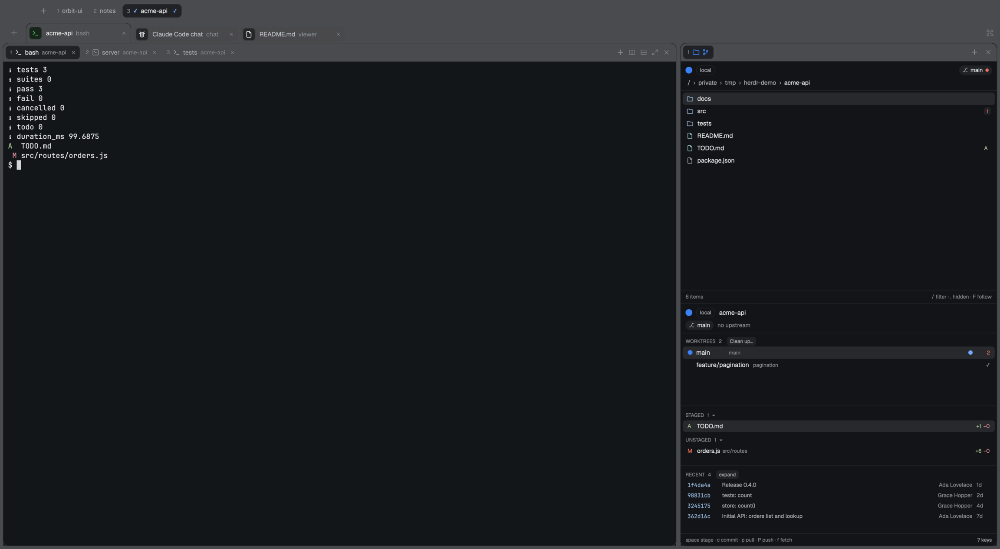
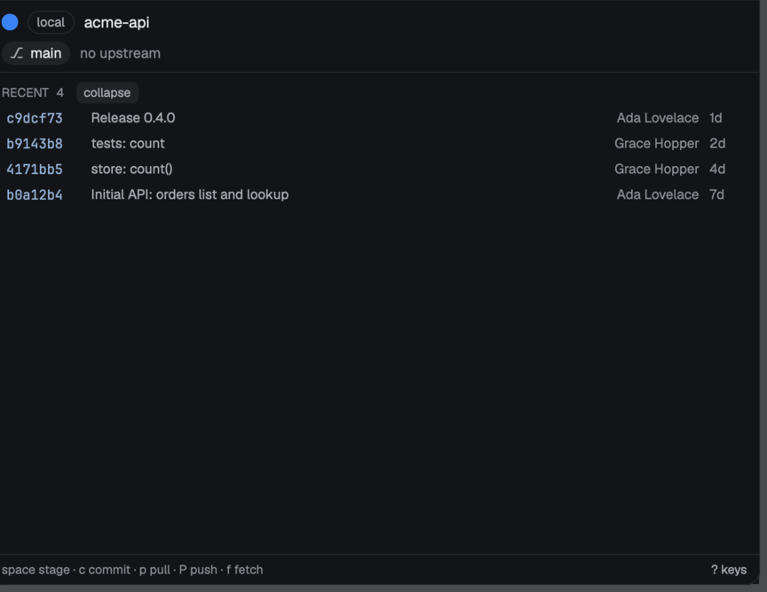

# herdr-mods

Personal mods for the [Herdr](https://herdr.dev) desktop app (`herdr-app`):
JavaScript panels drawn natively by Herdr's GPUI shell.



## Mods

| Mod | What it does |
|---|---|
| `spaces-bar` | Horizontal spaces bar along the top: this computer's spaces, a divider, then one chip per other machine (with a dropdown of its spaces), each machine in its own colour, filled while one of its spaces is shown. Each space lists its agents (a chat's agent shows as its chat, with the cow). Also: the **inbox** (after **+**: a red count of agents waiting for input, a dot for ones that finished; a dropdown of Needs you / Done / Working on every machine), the **Ctrl+Tab switcher** (recent tabs, Vivaldi-style: hold Ctrl, Tab to move, release to switch; spec 015) and the **quick switcher** (Ctrl+Space: find any open tab, nested tab, space or machine by name; spec 016). The inbox and both switchers include the other windows on this computer (njv-cachyos's default and work) |
| `terminals-bar-proc` | The tab bar: each tab shows the program running in it; the shown tab joins its pane like a file tab; scrolls when tabs don't fit; drag a tab to reorder it (palette: Tab: move left/right). **+** at the left: click for a shell (in the shown tab's folder), right-click for an agent or a chat. A remote space's machine pill is in the machine's colour. Closing a tab moves a chat's agent out first, so its session isn't ended |
| `nested-tabs` | Pane header with nested tabs (port of the herdr TUI fork's pane stacks; drag to reorder), and the per-tab nav/git panel. Right-click **+** for an agent or a chat; the cow button opens a running Claude Code or Codex terminal as a chat. A chat's own header (agent, conversation, its tools) is drawn in this row, so a chat pane has one header |
| `dock-tabs` | Tab strip for the window-level dock; its fixed tab holds nav and git as a split, with hayami's block under them; **+** adds shells, agents and chats as subtabs |
| `dock-follow` | Keeps the dock's nav and git on the focused pane's folder (a chat counts as its agent's folder); handles agent requests (`herdr-open`, `herdr-nav`); after a herdr-core restart (a reboot) resumes the Claude Code conversations it ended (`claude.session` labels from a SessionStart hook; `claude --resume` on Windows) |
| `nav` | Folder panel (spec 002): follows the focused terminal's folder, breadcrumbs, git marks, opens files in the viewer, right-click menu (open, edit, open in app, copy path) |
| `git` | Repository panel (spec 003): branch and upstream, worktrees with a light per agent (writes locked while an agent works there), changes with diffs, recent commits with their authors, drill-down (the message reflowed to the panel's width) and **Load 50 more** (**expand** makes the list fill the panel), lazygit keys, its own text size (A−/A+, keys `-` `=` `0`). **Clean up…** (spec 007) removes worktrees that are clean and pushed, with a checkbox each; root-owned files (Docker writing to a mapped volume) are handed back through default Docker; a kept worktree can be removed anyway with **Really remove…**, which says what is lost |
| `hayami` | hayami's readings under the dock's nav and git (specs 010, 011): usage (one line and one meter per account, as hayami draws it), bandwidth, cooler, peripherals and clock, from the hayami service on the shown space's machine, local or remote, through `lib/hayami.js` (hayami-js, below). Side by side in the bottom dock, stacked in the right one, the block sized to fit. **☰** in its header, a right-click, or the palette (`hayami: show/hide …`) chooses the sections, once per app home |
| `cria-file-preview` | File viewer in a tab (vendored from gsydler/herdr-cria, Apache-2.0; see `vendor/cria/VENDOR.md`): Markdown with images, links and Mermaid diagrams (needs `mmdc`, mermaid-cli), PDF, images, CSV/TSV, JSON, code, plus local diff view and "Open in <app>" |
| `ushi-naruse`, `ushi-naruse-file` | A chat view for Claude Code and Codex: our fork of naruse/herdr-chat, see [ushi-naruse](#ushi-naruse-chat-a-fork-of-naruseherdr-chat) |
| `term-menu` | Dock-aware terminal right-click menu |
| `ui-lab` | Capability demo: Claude ↔ panel round trip, usage meters, floating window |

## Gallery

Screenshots from a demo window with made-up projects ("acme-api", "orbit-ui") and
authors. `tools/gallery.sh` takes them again: it runs its own Herdr window on its own
herdr-core session (none of your spaces show), builds the demo projects in
`/tmp/herdr-demo`, sets up the scenes, takes the shots, checks each image with OCR for
your user, host and home folder, and removes everything it made.

| | |
|---|---|
| <br>**Chat** (`ushi-naruse`): your message on the left, a folded tool call, the reply with a code block, Claude's suggested next message above the box (Tab takes it). The tab has the cow; nav and git follow the chat's agent. | <br>**Viewer** (`cria-file-preview`): a Markdown file in a tab, with Preview, Raw, Edit and Open in an app. |
| <br>**Dock** (`nav`, `git`): the folder with git marks; the repository with its worktrees, staged and unstaged changes and recent commits with authors. | <br>**Recent, expanded** (`git`): the commit list fills the panel; **collapse** brings the rest back. |

## ushi-naruse (chat): a fork of naruse/herdr-chat

`ushi-naruse` ("ushi": cow) is a chat view over a running `claude` or `codex` terminal:
the session's log drawn as messages, Markdown and images, with a message box that
types into the agent. It is a fork of the `chat` and `chat-file` mods of
[naruse/herdr-chat](https://github.com/naruse/herdr-chat) (MIT), taken at commit
`05ef3ed` after a source review, and renamed so it can sit beside an upstream install.
Their layout, keys, tab bar, spaces sidebar and pane header are not used; this repo's
mods are. `FORK.md` in each mod names the source. Spec 008 has the full design.

Ways to open one:

- right-click **+** (tab bar, pane header or dock): **New Claude Code chat** / **New
  Codex chat**, a new tab (or dock subtab) holding only the chat, its agent running
  without a pane;
- the cow button in a pane header: **Open as chat** for a Claude Code or Codex terminal
  already running; the chat takes the terminal's place in its tab and the terminal
  hides;
- the palette or keys: `nested-tabs.chat`, `nested-tabs.open-chat`, `dock-tabs.chat`.

**Back to terminal** in the chat's header (or `ushi-naruse.back`) closes the chat and
puts the session back in its terminal, still running.

What we changed from upstream:

- **Layout**: your messages on the left, like the replies and Claude Code's terminal;
  tool calls in smaller text, their output in monospace as written; the conversation
  fills the pane instead of a centered 900 px column; a cow icon. Its header folds
  into the pane's header row (nested-tabs) in a tab.
- **What Claude shows**: its thinking (as Claude Code's terminal does), Mermaid
  diagrams in replies (drawn with mermaid-cli), a context meter (used / window)
  beside the model, bare URLs as links.
- **Copying**: a selection is copied when it's released (as in the herdr TUI), with a
  "Copied" pill; tool output is selectable too. A terminal panel (`/login`) has Copy
  link / Open link (its wrapping undone), and text typed with it open goes to its
  prompt; a /command typed then runs as a command.
- **History**: Up/Down in an empty box recalls what you sent.
- **Claude's suggested next message** (drawn only in its terminal, never logged) shows
  above the message box; click or Tab takes it to edit, **Send ↑** sends it as it is.
  Before sending, the agent's input line is emptied so nothing is sent in front of the
  message.
- **Parked sessions**: a Claude Code session parked as a background job is found
  through its job (upstream showed nothing).
- **Background work** (Claude Code): a background subagent or script shows running until
  Claude Code reports it done, with a subagent's tool count and step or a script's
  latest output; a strip above the message box lists what still runs (click to open
  its row, × to stop it); right-click a running row for **Stop**, which asks Claude
  to stop it. **Background N** (or the "still running" line) opens a dialog of all of
  it: each command (with Copy), how long it has run, its latest output.
- **Back to terminal**, and a `hide` prop that hides the terminal behind the chat when it
  opens (Open as chat).
- **One chat in every window**: the agent is found by a label (`ushi.id`), not by its
  address, which differs between windows (a machine's own window and another
  computer's window on it); and it
  hides its terminal when another mod asks (`×` on that terminal).
- **The cursor follows**: the message box takes the keyboard when the chat becomes
  the one in use (its pane focused in the active window: a switch, the inbox,
  another window raising this one).
- **Windows** (spec 014): in a Windows window, and for agents on Windows, with
  PowerShell where macOS and Linux use sh and python3.

What the other mods add around it: the menu entries, hidden only where the chat can't
run (macOS or Linux without `python3`, Codex on Windows, the agent not installed); an agent started for a chat ends
when its chat closes, a hidden terminal comes back as a tab when its chat closes, and
`×` on a chat's terminal hides it instead of ending the session; nav and git follow a
chat; the agents list opens it.

Needs `python3` on the agent's machine (the side chat, info cards and the resume list
talk to `claude -p` and `codex app-server` through it) and `claude` and/or `codex`;
on Windows, PowerShell does that part instead (spec 014), for Claude Code only (the
Codex bridge isn't ported yet). A window on any system can show a chat with an agent
on any machine. Changing the model or effort backs up
`~/.claude/settings.json` and puts it back about 2.4 s later (upstream behaviour).

## hayami-js

`lib/hayami.js` is a client for [hayami](https://github.com/ushineko/hayami)'s
service (`hayami-tui serve`, hayami spec 113; contract `api/openapi.yaml`, prose
`docs/api.md` there). It belongs to this repository, not to hayami. Mods have no
sockets, so each request is one command on the machine that serves it: `curl
--unix-socket` on Linux and macOS, `hayami-tui api get` on Windows. Every
section is drawn (`hayami`); bandwidth and cooler are read every 5 s, the others less
often, and only the sections shown are asked for.

Needs, on each machine the dock follows: the hayami service set up (hayami's
installer on Linux and Windows; `hayami-tui api-service install` on macOS) and
`curl`. Without the service the block says "hayami service not running".

## Where mods run

Mods run only in the herdr-app window, on the machine that window runs on. A Mac
window runs the Mac's copies even for a remote machine's terminals; commands for the
remote go there through herdr-core (`exec(..., { on })`). A Linux window runs Linux's
copies. So install on every machine where a window is opened; `bin/` and `skills/`
go where agents run. A window without these mods works as plain Herdr.

## Agent commands and skills

`bin/herdr-open`, `bin/herdr-nav` (on `bin/herdr-request`) let a Claude session in a
Herdr terminal show a file (viewer, diff, editor, external app) or point the nav and
git panels (spec 005). They are bash: macOS and Linux only for now. The skills in `skills/` tell agents when to use them. The source
lives here; `install.sh` symlinks `bin/*` into `~/.local/bin` and `skills/*` into
`~/.claude/skills`. Per-machine external apps: `~/.config/herdr-mods/external.json`
(see `config/external.example.json`).

## Tests

```sh
npm test               # ./run-tests.sh: ours + the vendored cria tests, under a throwaway TMPDIR
tools/test-windows.sh  # the same on win11-kvm (run on njv-cachyos; pushed HEAD)
```

## Keys

The mods' key commands, bound in each app home's `keys.json` (`global`; the
machines' own files are snapshotted in dotfiles):

| Key | Command |
|---|---|
| Ctrl+Tab / Ctrl+Shift+Tab | `spaces-bar.switch` / `spaces-bar.switch-back`: recent tabs |
| Ctrl+Space | `spaces-bar.find`: the quick switcher (on macOS, its input-source shortcut takes Ctrl+Space first when it has several input sources) |
| Ctrl+Shift+A, Ctrl+Shift+←/→ | `nested-tabs.add`, `.next`, `.prev` (Cmd on macOS) |

## Requirements

The Herdr app and herdr-core on each machine, and these programs where a mod uses
them. Windows' commands go through PowerShell, which Windows always has.

| Program | Used by | macOS | Linux (CachyOS/Arch) | Windows |
|---|---|---|---|---|
| node | `install.sh`, the tests | `brew install node` | `pacman -S nodejs` | `winget install OpenJS.NodeJS.LTS` |
| bash, coreutils | `install.sh` | built in | built in | Git for Windows (Git Bash; run `install.sh --no-agent` there) |
| git | `git`, `nav` (marks), the chat's @-mention list | built in (Xcode tools) | `pacman -S git` | Git for Windows |
| python3 | the chat, on the agent's machine (side chat, info cards, resume list) | built in | `pacman -S python` | not needed: PowerShell |
| mermaid-cli (`mmdc`) | Mermaid diagrams in the viewer and the chat | `brew install mermaid-cli` | `pacman -S mermaid-cli` (with Chromium) | `npm install -g @mermaid-js/mermaid-cli` (dotfiles: `windows/install.ps1 -Components mermaid-cli`) |
| poppler (`pdftoppm`, `pdfinfo`) | PDFs in the viewer | not needed: PDFKit | `pacman -S poppler` | not needed: Windows' own |
| wl-clipboard or xclip | the chat's copy and pasted screenshots | not needed: pbcopy, osascript | `pacman -S wl-clipboard` (Wayland) or `xclip` | not needed: PowerShell |
| hayami service | `hayami` (usage under the dock) | see [hayami-js](#hayami-js) | see [hayami-js](#hayami-js) | see [hayami-js](#hayami-js) |

A missing program shows as a note where it's needed ("Mermaid isn't installed
(mermaid-cli)", "PDF previews need pdftoppm…"), not as an error.

## Install

```sh
./install.sh                     # all mods into ~/.config/herdr-app
./install.sh ui-lab              # one mod
# Two app homes on one machine: the first gets copies, the second links to them
./install.sh --home ~/.config/herdr-app --link ~/.config/herdr-app-second
```

On Windows, run it in Git Bash with `--no-agent` (the agent commands are bash
scripts), and install the sign-in tasks that keep herdr-core where the app can reach
it, from an elevated PowerShell:
`powershell -ExecutionPolicy Bypass -File tools\windows\install-logon-tasks.ps1`
(spec 013: a core an SSH connection starts is elevated, and the app can't open it).

Herdr does not hot-reload a mod reached through a symlink, so the app home
gets real copies. Edit here, then run `./install.sh`; Herdr reloads the
changed mods within a second. Check a mod with
`herdr-app check ~/.config/herdr-app/mods/<name>`.

The API reference is written by the app on every start:
`~/.config/herdr-app/AGENTS.md`, `herdr.d.ts`, `gpui-kit.d.ts`.

## History

The first six mods were moved here from a private configuration repository; their
earlier history stays there.
