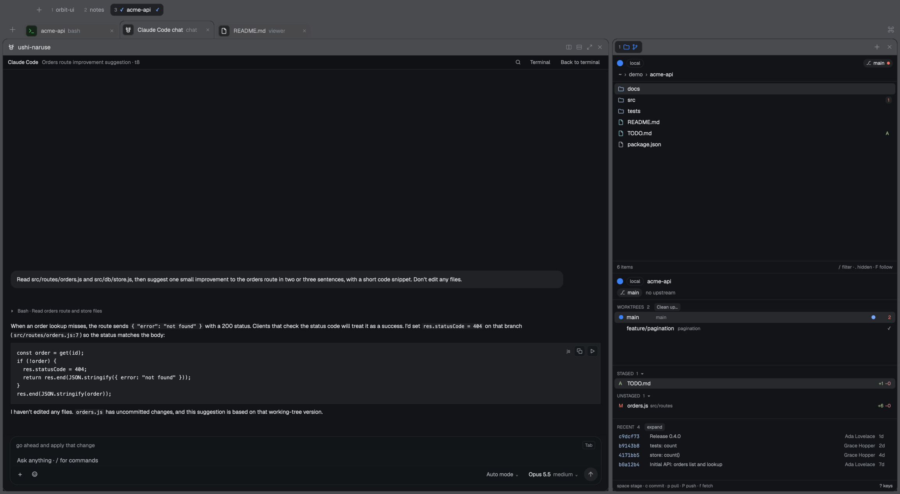
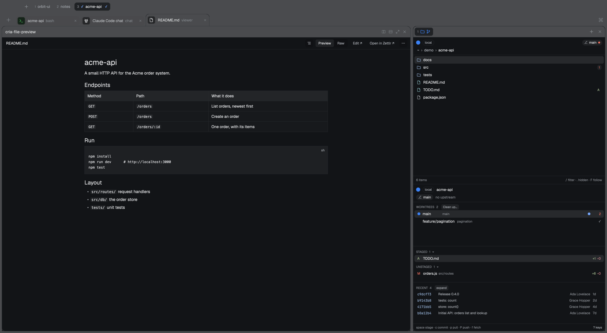
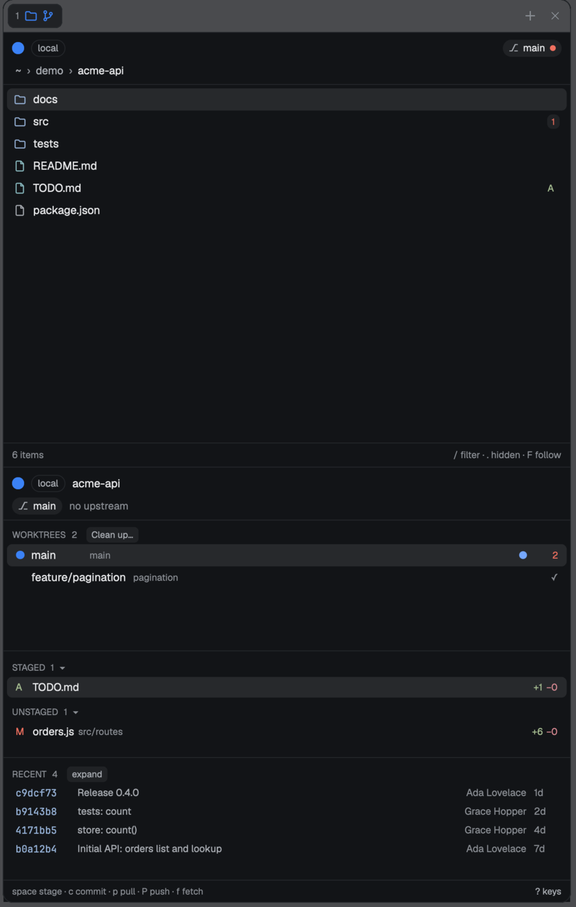

# herdr-mods

Personal mods for the [Herdr](https://herdr.dev) desktop app (`herdr-app`):
JavaScript panels drawn natively by Herdr's GPUI shell.


## Mods

| Mod | What it does |
|---|---|
| `spaces-bar` | Horizontal spaces bar along the top; remote machines fold into one chip with a dropdown. Each space lists its agents (a chat's agent shows as its chat, with the cow) |
| `terminals-bar-proc` | The tab bar: each tab shows the program running in it; the shown tab joins its pane like a file tab; scrolls when tabs don't fit. **+** at the left: click for a shell, right-click for an agent or a chat. Closing a tab moves a chat's agent out first, so its session isn't ended |
| `nested-tabs` | Pane header with nested tabs (port of the herdr TUI fork's pane stacks), and the per-tab nav/git panel. Right-click **+** for an agent or a chat; the cow button opens a running Claude Code or Codex terminal as a chat |
| `dock-tabs` | Tab strip for the window-level dock; its fixed tab holds nav and git as a split; **+** adds shells, agents and chats as subtabs |
| `dock-follow` | Keeps the dock's nav and git on the focused pane's folder (a chat counts as its agent's folder); handles agent requests (`herdr-open`, `herdr-nav`) |
| `nav` | Folder panel (spec 002): follows the focused terminal's folder, breadcrumbs, git marks, opens files in the viewer, right-click menu (open, edit, open in app, copy path) |
| `git` | Repository panel (spec 003): branch and upstream, worktrees with a light per agent (writes locked while an agent works there), changes with diffs, recent commits with their authors, drill-down and **Load 50 more** (**expand** makes the list fill the panel), lazygit keys. **Clean up…** (spec 007) removes worktrees that are clean and pushed, with a checkbox each; root-owned files (Docker writing to a mapped volume) are handed back through default Docker; a kept worktree can be removed anyway with **Really remove…**, which says what is lost |
| `cria-file-preview` | File viewer in a tab (vendored from gsydler/herdr-cria, Apache-2.0; see `vendor/cria/VENDOR.md`): Markdown with images and links, PDF, images, CSV/TSV, JSON, code, plus local diff view and "Open in <app>" |
| `ushi-naruse`, `ushi-naruse-file` | A chat view for Claude Code and Codex: our fork of naruse/herdr-chat, see [ushi-naruse](#ushi-naruse-chat-a-fork-of-naruseherdr-chat) |
| `term-menu` | Dock-aware terminal right-click menu |
| `ui-lab` | Capability demo: Claude ↔ panel round trip, hayami usage meters, floating window |

## Gallery

Screenshots from a demo window with made-up projects ("acme-api", "orbit-ui") and
authors.

| | |
|---|---|
| <br>**Chat** (`ushi-naruse`): your message on the left, a folded tool call, the reply with a code block, Claude's suggested next message above the box (Tab takes it). The tab has the cow; nav and git follow the chat's agent. | <br>**Viewer** (`cria-file-preview`): a Markdown file in a tab, with Preview, Raw, Edit and Open in an app. |
| <br>**Dock** (`nav`, `git`): the folder with git marks; the repository with its worktrees, staged and unstaged changes and recent commits with authors. | <br>**Recent, expanded** (`git`): the commit list fills the panel; **collapse** brings the rest back. |

## ushi-naruse (chat): a fork of naruse/herdr-chat

`ushi-naruse` ("ushi": cow) is a chat view over a running `claude` or `codex` terminal:
the session's log drawn as messages, Markdown and images, with a message box that
types into the agent. It is a fork of the `chat` and `chat-file` mods of
[naruse/herdr-chat](https://github.com/naruse/herdr-chat) (MIT), taken at commit
`05ef3ed` after a source review, and renamed so it can sit beside an upstream install.
Their layout, keys, tab bar, spaces sidebar and pane header are not used; this repo's
mods are. `FORK.md` in each mod names the source. Spec 008 has the full design.

Ways to open one:

- right-click **+** (tab bar, pane header or dock): **New Claude Code chat** / **New
  Codex chat**, a new tab (or dock subtab) holding only the chat, its agent running
  without a pane;
- the cow button in a pane header: **Open as chat** for a Claude Code or Codex terminal
  already running; the chat takes the terminal's place in its tab and the terminal
  hides;
- the palette or keys: `nested-tabs.chat`, `nested-tabs.open-chat`, `dock-tabs.chat`.

**Back to terminal** in the chat's header (or `ushi-naruse.back`) closes the chat and
puts the session back in its terminal, still running.

What we changed from upstream:

- **Layout**: your messages on the left, like the replies and Claude Code's terminal;
  tool calls in smaller text, their output as plain monospace lines; the conversation
  fills the pane instead of a centered 900 px column; a cow icon.
- **Claude's suggested next message** (drawn only in its terminal, never logged) shows
  above the message box; click or Tab takes it. Before sending, the agent's input line
  is emptied so nothing is sent in front of the message.
- **Parked sessions**: a Claude Code session parked as a background job is found
  through its job (upstream showed nothing).
- **Back to terminal**, and a `hide` prop that hides the terminal behind the chat when it
  opens (Open as chat).
- **One chat in every window**: the agent is found by a label (`ushi.id`), not by its
  address, which differs between windows (the Mac's and njv-cachyos's own); and it
  hides its terminal when another mod asks (`×` on that terminal).

What the other mods add around it: the menu entries, hidden only where the chat can't
run (Windows, no `python3`, the agent not installed); an agent started for a chat ends
when its chat closes, a hidden terminal comes back as a tab when its chat closes, and
`×` on a chat's terminal hides it instead of ending the session; nav and git follow a
chat; the agents list opens it.

Needs `python3` on the agent's machine (the side chat, info cards and the resume list
talk to `claude -p` and `codex app-server` through it) and `claude` and/or `codex`.
macOS and Linux; not offered on Windows. Changing the model or effort backs up
`~/.claude/settings.json` and puts it back about 2.4 s later (upstream behaviour).

## Where mods run

Mods run only in the herdr-app window, on the machine that window runs on. A Mac
window runs the Mac's copies even for a remote machine's terminals; commands for the
remote go there through herdr-core (`exec(..., { on })`). A Linux window runs Linux's
copies. So install on every machine where a window is opened; `bin/` and `skills/`
go where agents run. A window without these mods works as plain Herdr.

## Agent commands and skills

`bin/herdr-open`, `bin/herdr-nav` (on `bin/herdr-request`) let a Claude session in a
Herdr terminal show a file (viewer, diff, editor, external app) or point the nav and
git panels (spec 005). The skills in `skills/` tell agents when to use them. The source
lives here; `install.sh` symlinks `bin/*` into `~/.local/bin` and `skills/*` into
`~/.claude/skills`. Per-machine external apps: `~/.config/herdr-mods/external.json`
(see `config/external.example.json`).

## Tests

```sh
npm test    # ./run-tests.sh: ours + the vendored cria tests, under a throwaway TMPDIR
```

## Install

```sh
./install.sh                     # all mods into ~/.config/herdr-app
./install.sh ui-lab              # one mod
# njv-cachyos: default home gets copies, work home gets symlinks to them
./install.sh --home ~/.config/herdr-app --link ~/.config/herdr-app-work
```

Herdr does not hot-reload a mod reached through a symlink, so the app home
gets real copies. Edit here, then run `./install.sh`; Herdr reloads the
changed mods within a second. Check a mod with
`herdr-app check ~/.config/herdr-app/mods/<name>`.

The API reference is written by the app on every start:
`~/.config/herdr-app/AGENTS.md`, `herdr.d.ts`, `gpui-kit.d.ts`.

## History

The first six mods were moved here from
`ushineko/dotfiles:setup/njv-cachyos/herdr-app/default/mods` (last commit there:
`fe01cbb`). Their earlier history is in that repo.
