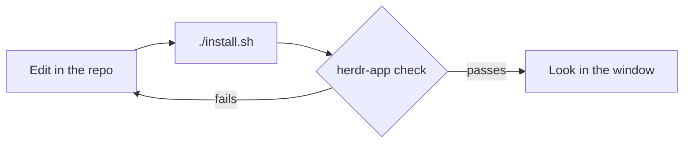
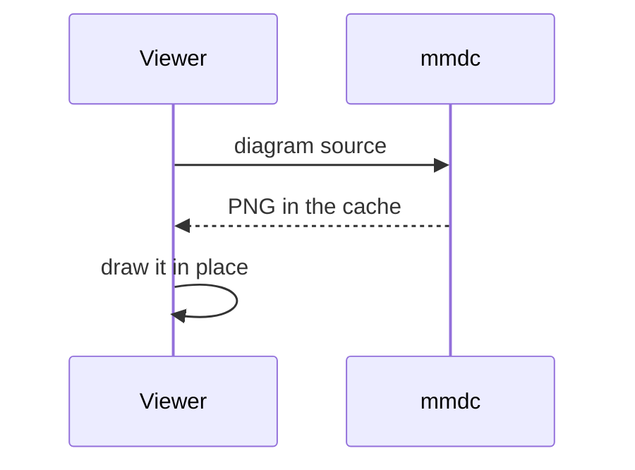

# Mermaid sample

A sample for the Markdown viewer's Mermaid diagrams (spec 012).

## Flowchart



## Sequence



## Broken

This one has an error, so its code shows, with Mermaid's message under it.

```mermaid
flowchart LR
  A -->
```

## Ordinary code

```js
const stays = "code";
```
